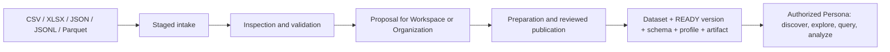

# Resource Registry for Data Analysis

For file-level external synchronization, the backend now provides a
[generic source contract](EXTERNAL_SOURCE_SYNC.md). It is separate from the existing
SharePoint manifest producer described below; Graph and folder synchronization remain
the connector's responsibility.

**Status:** description of the repository implementation, reviewed October 23, 2026.  
**Audience:** data analysis team, Workspace owners, and platform team.  
**Scope:** published tabular datasets and Resource Registry tools available to Personas.

## Meeting summary

Resource Registry registers tabular files as **Datasets with immutable versions**, schemas, basic
profiles, artifacts, and provenance. An authorized Persona can discover them and answer questions
through bounded exploration, controlled SQL queries, predefined analysis, and data-backed charts.
Access depends on the active Workspace, Persona, user, and Dataset policies; the language model
does not receive direct storage access. [Data models](../models.py),
[BIFs](RESOURCE_REGISTRY_BIFS_OVERVIEW.md), [access](RESOURCE_REGISTRY_ROLES_AND_ACCESS.md).

**Good fit:** discovering published sources, inspecting columns and initial data quality,
calculating aggregates from one dataset, comparing revisions, and delivering small, traceable
results. **Needs another solution or further development:** joins across datasets, unlimited
large-result queries, flexible dashboards, and physical PDF/PPTX exports through the current export
flow. [SQL validator](../services/dataset_query_executor.py),
[charts](../services/dataset_chart_service.py),
[exports](../services/artifact_generation_service.py).

## 1. How data enters the Registry



1. An operator uploads a file through Django Admin or the intakes API. The formats allowed by
   default are CSV, XLSX, JSON, JSONL/NDJSON, and Parquet, subject to environment allowlists and
   limits. `.xls`, PDF, archives, and password-protected workbooks are outside this intake flow.
   [File preparation](RESOURCE_REGISTRY_FILE_PREPARATION.md),
   [intakes API](RESOURCE_REGISTRY_INTAKES_API.md).
2. Inspection moves the intake to `READY_FOR_PUBLICATION`. Dataset Management prepares a
   proposal asynchronously for an explicit destination; publishing applies the reviewed result
   atomically. An invalid selected Excel sheet blocks that proposal. The retained legacy
   intake publication path instead queues registration and can complete with skipped sheets. [Publication](RESOURCE_REGISTRY_DATASET_PUBLICATION.md),
   [worker operations](RESOURCE_REGISTRY_WORKER_OPERATIONS.md).
3. Registration materializes queryable content as Parquet, except that a valid uploaded Parquet
   preserves its native bytes and types. A tabular file produces one Dataset; an XLSX workbook can
   produce one per accepted sheet. Each `READY` version retains a schema, basic profile, and content
   hash. [Formats](DATASET_FORMATS.md), [versions](RESOURCE_REGISTRY_DATASET_VERSIONING.md),
   [persistence](../services/registry/dataset_registry_service.py).

An upload is a **complete snapshot**. To update data, prepare a proposal with the existing
Dataset ID and revision, then publish after review. Filenames do not select the target.
Identical content returns `NO_CHANGES`; historical content needs manager approval. Readers
use `current_version`, which can point to an older immutable version after restoration. [Versioning](RESOURCE_REGISTRY_DATASET_VERSIONING.md).

The SharePoint `RESOURCE_REGISTRY` integration produces a **CSV file manifest** by recursively
crawling a folder. That manifest describes assets; this mode does not automatically ingest the
rows of every SharePoint file or generate embeddings. Clarify this distinction if the team expects
to analyze the tabular contents of all synchronized files.
[SharePoint configuration](../../Embeddings/models.py).

## 2. What an analyst can do

| Need | Current capability | Canonical Persona actions |
| --- | --- | --- |
| Find sources | List visible Datasets and read descriptions, context, and versions | `list_datasets`, `get_dataset`, `get_dataset_context`, `list_dataset_versions` |
| Understand structure and initial quality | Read columns and types; a persisted profile with row/column counts and schema quality signals | `get_dataset_schema`, `get_dataset_profile` |
| Inspect values | Distinct or frequent values, samples, searches, and column profiles, within limits | `explore_dataset` |
| Answer quantitative questions | Deterministic plans for simple cases or controlled SQL `SELECT` on one Dataset | `plan_query`, `query_dataset` |
| Run a query in the background | Submit a job, check its status, and retrieve its result; access is checked again during execution | `start_query_job`, `get_query_job_status`, `get_query_job_result` |
| Run predefined analysis | Summary, preview, top categories, numeric distribution, and campaign opportunities | `analyze_dataset`; also intelligence jobs |
| Visualize | Chart specification and data for bar, line, pie, scatter, or table | `create_chart`, `get_chart_artifact` |
| Create reusable output | Dataset filtered by a numeric threshold; bounded CSV/XLSX export planning and generation | `create_filtered_dataset`, `plan_export`, `generate_artifact` |
| Run an approved transformation | Start and observe a transformation definition/version under permissions and operational limits | `start_transformation_run`, run/step/output reads |

The names in the table are canonical actions and omit the `resource_registry_` prefix. They are
assigned individually to Personas but published to the model through four grouped tools:
`resource_registry_inspect`, `resource_registry_query`,
`resource_registry_manage_outputs`, and `resource_registry_manage_transformations`. A model call
always selects one assigned action inside its group; it never receives the canonical actions as
independent tools. The full mapping and per-action constraints are in the
[BIF catalog](RESOURCE_REGISTRY_BIF_CATALOG.md). The profile persisted at registration contains
**basic aggregate metadata**, not a complete report on nulls, outliers, or per-column
distributions. Those questions need exploration or an explicit query.
[Profile persistence](../services/registry/dataset_registry_service.py),
[analysis service](../services/dataset_analysis_service.py).

### Example of a reproducible question

For “sales by channel, delivered transactions only,” first select a visible Dataset and a `READY`
version, then inspect its schema. If `channel`, `status`, and `net_amount` exist and have the expected
business meanings, one possible query is:

```sql
SELECT channel, COUNT(*) AS transactions, SUM(net_amount) AS recorded_amount
FROM dataset
WHERE status = 'delivered'
GROUP BY channel
ORDER BY recorded_amount DESC
LIMIT 10
```

Report the version ID, filter, validated currency unit, and meaning of `net_amount`. The built-in
bar chart does **not** apply this query's `status` filter by itself; it uses its own aggregation.
The natural-language planner supports limited shapes and its observed patterns are mainly in
English. Inspect its generated SQL before interpreting a request in another language.
[Planner](../services/query_planner.py), [charts](../services/dataset_chart_service.py),
[visualization guide](resource_registry_visualization_playbook.md).

## 3. Concrete benefits for analysis

- **Traceability:** logical Dataset, hashed versions, schema, profile, provenance, and lineage for
  derived output. Pinning a `version_id` prevents mixing revisions in one answer.
  [Models](../models.py), [versioning](RESOURCE_REGISTRY_DATASET_VERSIONING.md).
- **Access governance:** a Persona can use only assigned canonical actions. Organization,
  Workspace, role, policy, Dataset visibility, and permitted columns are also checked. Knowing an
  ID does not expand access. [BIFs](RESOURCE_REGISTRY_BIFS_OVERVIEW.md),
  [roles](RESOURCE_REGISTRY_ROLES_AND_ACCESS.md).
- **Bounded queries:** validated SQL, small results, and asynchronous options with durable
  status. Analysts can answer aggregate questions without loading the whole file into the
  assistant's context. [Executor](../services/dataset_query_executor.py),
  [jobs](../services/dataset_query_job_execution_service.py).
- **Varied input and normalization:** five input format families, schema inference, and a
  queryable canonical representation. Nested JSON retains JSON values and can be queried with
  supported JSON functions. [Preparation](RESOURCE_REGISTRY_FILE_PREPARATION.md),
  [formats](DATASET_FORMATS.md).

## 4. Limits and design decisions that affect the team

| Current limit | Impact on analysis | Alternative or precaution |
| --- | --- | --- |
| Uploads allow up to 10 GiB per file by default, but the materialization policy limits registration to 100 MiB by default; XLSX also has a 100 MiB processing limit | A file can upload successfully and then fail to become a Dataset | Confirm the tenant's effective policy and format limit before uploading large files. [Upload](../../BotPlatform/resource_registry_settings.py), [policy](../policies/defaults.py), [registration](../application/dataset_registration.py) |
| SQL allows only one `SELECT` on the `dataset` relation, with `LIMIT`; it rejects `JOIN`, `UNION`, CTEs, subqueries, file-reading functions, and `SELECT *` | The BIF cannot join Datasets or run arbitrary SQL | Prepare a consolidated source or an approved transformation before analysis. [Validator](../services/dataset_query_executor.py) |
| Synchronous queries return at most 100 rows by default; asynchronous results are also configured for 100 rows by default | The assistant provides bounded evidence, not full extracts | Use aggregates and confirm the environment's effective limits. [Executor](../services/dataset_query_executor.py), [configuration](../../BotPlatform/resource_registry_settings.py) |
| Routing may require an asynchronous job when an artifact exceeds 100 MiB by default; time, concurrency, cache, and temporary storage are limited | Large files or costly queries may take longer, fail, or need an active worker | Review size, plan, and job status with platform operations. [Routing](../services/dataset_query_routing_policy.py), [configuration](../../BotPlatform/resource_registry_settings.py) |
| The initial profile records counts and schema quality, without exhaustive statistical profiling | `get_dataset_profile` alone cannot establish overall quality or the absence of nulls/outliers | Validate fields, nulls, and metrics with explicit queries. [Profile](../services/registry/dataset_registry_service.py) |
| Deterministic charts: bar sums one metric by dimension (10 groups), pie counts records (6), line sums by month (24), scatter shows 100 rows, and table shows 20 rows/5 columns | The built-in chart has no arbitrary filters, averages, multiple series, or guaranteed representative sample | Inspect `source_query`, axes, and data; use SQL for custom calculations and another visualization client when appropriate. [Service](../services/dataset_chart_service.py), [guide](resource_registry_visualization_playbook.md) |
| `plan_export` accepts `csv`, `xlsx`, `pdf`, and `pptx`, but `generate_artifact` registers physical generators only for CSV/XLSX | A PDF/PPTX plan does not guarantee a file; generation returns `unsupported_artifact_type` | Promise only physical CSV/XLSX files through this flow. [Plan](../services/dataset_export_plan_service.py), [generator](../services/artifact_generation_service.py) |
| Intelligence results include predefined analysis, without causal inference or unrestricted statistical modeling | Automated recommendations need review against evidence and business definitions | Present the method, filter, denominator, and version; have an analyst validate conclusions. [Analysis](../services/dataset_analysis_service.py) |
| Updates depend on publishing a new version and on active workers | A Dataset is not a real-time transactional table | Define a publication cadence and check for `READY` before reporting. [Publication](RESOURCE_REGISTRY_DATASET_PUBLICATION.md), [workers](RESOURCE_REGISTRY_WORKER_OPERATIONS.md) |

The numerical limits above are **code defaults**; deployments may configure different values.
Tenant or Dataset policy can also disable capabilities. This review does not measure performance
or availability in the meeting's environment.
[Configuration](../../BotPlatform/resource_registry_settings.py),
[access](RESOURCE_REGISTRY_ROLES_AND_ACCESS.md).

## 5. Access and operations needed for a demonstration

| Effective Registry role | Typical use |
| --- | --- |
| `restricted_reader` (ordinary user) | Discovery, metadata, exploration, planning, bounded SQL, and their own query jobs. |
| `reader` (`unicornai-power-users` or other mapped groups) | The above, plus analysis, charts, exports, derived Datasets, and transformation history, when each capability is allowed. |
| `admin` (superuser or `unicornai-admin`) | May start transformations, subject to permissions, scopes, provider, and operational limits. |

Roles do not grant universal access. The Organization and Workspace must be active with Registry
enabled; the Namespace must be provisioned; the user must be admitted to the Workspace; the
Persona must be associated with that Workspace and assigned the canonical action. A `WORKSPACE` Dataset is
visible only in its Workspace; an `ORGANIZATION` Dataset can appear in authorized Workspaces of
the same Organization. Publishing intakes requires additional permissions separate from query
roles. [Roles](RESOURCE_REGISTRY_ROLES_AND_ACCESS.md),
[getting started](RESOURCE_REGISTRY_GETTING_STARTED.md),
[publication](RESOURCE_REGISTRY_DATASET_PUBLICATION.md).

**Suggested meeting sequence:** publish a sample CSV beforehand; confirm that its version is
`READY`; list Datasets; review schema and profile; run a query with `LIMIT 10`; compare its result
with a built-in chart; show the version ID and explain filters and limits. For a private Workspace,
check user membership and Persona action assignments before the meeting.
[Getting started](RESOURCE_REGISTRY_GETTING_STARTED.md),
[catalog](RESOURCE_REGISTRY_BIF_CATALOG.md).

## 6. Questions to settle with the team

1. Which sources matter most, and how often must a new version be published? Are snapshots
   sufficient?
2. Which metrics, units, filters, and denominators have approved business definitions?
3. Does the team need to join Datasets, return more than 100 rows, or produce dashboards or
   PDF/PPTX files? Those cases need another product path or further work.
4. Which data should be Workspace-scoped and which should be shared across the Organization? Who
   owns publication, quality review, and removal of destination assignments?

**Evidence base:** the repository code and documentation linked above. No live upload or query
was run against the deployment; effective limits and Persona configuration should be confirmed
in that environment.
