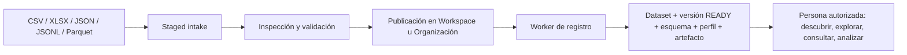

# Resource Registry para análisis de datos

**Estado:** descripción de la implementación del repositorio, revisada el 16 de octubre de 2026.  
**Audiencia:** equipo de análisis de datos, responsables de Workspaces y plataforma.  
**Alcance:** datasets tabulares publicados y herramientas de Resource Registry disponibles para Personas.

## Resumen para la reunión

Resource Registry registra archivos tabulares como **Datasets con versiones inmutables**, esquema,
perfil básico, artefactos y procedencia. Una Persona autorizada puede descubrirlos y responder
preguntas mediante exploración acotada, consultas SQL controladas, análisis predefinidos y gráficos
basados en datos. El acceso depende del Workspace activo, la Persona, el usuario y las políticas del
Dataset; el modelo de lenguaje no recibe acceso directo al almacenamiento. [Modelo de datos](../models.py),
[BIFs](RESOURCE_REGISTRY_BIFS_OVERVIEW.md), [acceso](RESOURCE_REGISTRY_ROLES_AND_ACCESS.md).

**Encaja bien** para descubrir fuentes publicadas, inspeccionar columnas y calidad inicial,
calcular agregados de un dataset, comparar revisiones y entregar resultados pequeños con trazabilidad.
**Requiere otra solución o desarrollo adicional** para joins entre datasets, consultas masivas sin
límites, dashboards flexibles y exportaciones PDF/PPTX físicas desde el flujo de exportación actual.
[Validador SQL](../services/dataset_query_executor.py),
[gráficos](../services/dataset_chart_service.py),
[exportación](../services/artifact_generation_service.py).

## 1. Cómo llega la información



1. Un operador carga un archivo mediante Django Admin o la API de intakes. Los formatos admitidos
   por defecto son CSV, XLSX, JSON, JSONL/NDJSON y Parquet, sujetos a las listas permitidas y los
   límites del entorno. `.xls`, PDF, archivos comprimidos y libros protegidos por contraseña no
   forman parte de este flujo. [Preparación de archivos](RESOURCE_REGISTRY_FILE_PREPARATION.md),
   [API de intakes](RESOURCE_REGISTRY_INTAKES_API.md).
2. La inspección deja el intake en `READY_FOR_PUBLICATION`; el operador elige explícitamente una
   ubicación. La publicación inicia trabajo asíncrono: **publicado** todavía no significa **dataset
   consultable**. CSV, JSON, JSONL y Parquet se registran por un worker; XLSX se procesa por hojas
   y puede terminar con hojas omitidas. [Publicación](RESOURCE_REGISTRY_DATASET_PUBLICATION.md),
   [operación de workers](RESOURCE_REGISTRY_WORKER_OPERATIONS.md).
3. El registro materializa contenido consultable en Parquet, excepto que un Parquet válido conserva
   sus bytes y tipos nativos. Un archivo tabular produce un Dataset; un XLSX puede producir uno por
   hoja aceptada. Cada versión `READY` conserva esquema, perfil básico y hash del contenido.
   [Formatos](DATASET_FORMATS.md), [versiones](RESOURCE_REGISTRY_DATASET_VERSIONING.md),
   [persistencia](../services/registry/dataset_registry_service.py).

La carga es un **snapshot**. Para actualizar datos se publica un archivo corregido en el mismo
destino y con el mismo nombre completo; si cambia el contenido se crea la siguiente versión. Un
archivo idéntico reutiliza la versión; cambiar nombre o extensión normalmente crea otro Dataset.
No se debe editar una versión `READY` directamente. [Versionado](RESOURCE_REGISTRY_DATASET_VERSIONING.md).

La integración `RESOURCE_REGISTRY` de SharePoint genera un **manifiesto CSV de archivos** mediante
un recorrido de la carpeta. Ese manifiesto describe activos; no ingiere automáticamente las filas
de cada archivo de SharePoint ni genera embeddings para este modo. Conviene aclarar esta diferencia
si el equipo espera analizar el contenido tabular de todos los archivos sincronizados.
[Configuración de SharePoint](../../Embeddings/models.py).

## 2. Qué puede hacer un analista

| Necesidad | Capacidad actual | Herramientas de Persona |
| --- | --- | --- |
| Encontrar fuentes | Listar Datasets visibles y leer descripción, contexto y versiones | `list_datasets`, `get_dataset`, `get_dataset_context`, `list_dataset_versions` |
| Entender estructura y calidad inicial | Leer columnas y tipos; perfil persistido con conteo de filas/columnas y señales de calidad del esquema | `get_dataset_schema`, `get_dataset_profile` |
| Inspeccionar valores | Valores distintos o frecuentes, muestras, búsquedas y perfil de columna, con límites | `explore_dataset` |
| Responder preguntas cuantitativas | Plan determinista para casos simples o SQL `SELECT` controlado sobre un Dataset | `plan_query`, `query_dataset` |
| Dejar una consulta en segundo plano | Enviar job, revisar estado y recuperar resultado; se vuelve a comprobar el acceso al ejecutar | `start_query_job`, `get_query_job_status`, `get_query_job_result` |
| Análisis predefinido | Resumen, vista previa, categorías principales, distribución numérica y oportunidades de campaña | `analyze_dataset`; también jobs de inteligencia |
| Visualizar | Especificación y datos para barra, línea, pastel, dispersión o tabla | `create_chart`, `get_chart_artifact` |
| Crear salida reutilizable | Dataset filtrado por umbral numérico; plan y generación de CSV/XLSX acotados | `create_filtered_dataset`, `plan_export`, `generate_artifact` |
| Ejecutar transformación aprobada | Iniciar y observar una definición/version de transformación bajo permisos y límites operativos | `start_transformation_run`, lectura de runs/steps/outputs |

Los nombres de la tabla omiten el prefijo `resource_registry_`. La lista completa y las
restricciones por función están en el [catálogo BIF](RESOURCE_REGISTRY_BIF_CATALOG.md). El perfil
persistido durante el registro contiene **metadatos agregados básicos**, no un informe completo de
nulos, outliers o distribuciones por columna; esas preguntas requieren exploración o una consulta
explícita. [Persistencia del perfil](../services/registry/dataset_registry_service.py),
[servicio de análisis](../services/dataset_analysis_service.py).

### Ejemplo de pregunta reproducible

Para “ventas por canal, solo transacciones entregadas”, primero se elige un Dataset visible y una
versión `READY`, luego se inspecciona el esquema. Si existen `channel`, `status` y `net_amount` y su
semántica es la esperada, una consulta posible es:

```sql
SELECT channel, COUNT(*) AS transactions, SUM(net_amount) AS recorded_amount
FROM dataset
WHERE status = 'delivered'
GROUP BY channel
ORDER BY recorded_amount DESC
LIMIT 10
```

Se debe informar el ID de versión, el filtro, la unidad monetaria validada y el significado de
`net_amount`. El gráfico incorporado de barras **no aplica** por sí mismo el filtro `status` de
esta consulta; usa su propia agregación. El planificador por lenguaje natural cubre formas
limitadas y sus patrones observados están principalmente en inglés: conviene inspeccionar el SQL
generado antes de interpretar una petición en español. [Planificador](../services/query_planner.py),
[gráficos](../services/dataset_chart_service.py),
[guía de visualización](resource_registry_visualization_playbook.md).

## 3. Ventajas concretas para análisis

- **Trazabilidad:** Dataset lógico, versiones con hash, esquema, perfil, procedencia y linaje para
  salidas derivadas. Fijar un `version_id` evita mezclar revisiones en una misma respuesta.
  [Modelos](../models.py), [versionado](RESOURCE_REGISTRY_DATASET_VERSIONING.md).
- **Gobierno de acceso:** una Persona solo puede usar BIFs asignadas; además se verifican
  Organización, Workspace, rol, política, visibilidad del Dataset y columnas permitidas. Un ID
  conocido no amplía el acceso. [BIFs](RESOURCE_REGISTRY_BIFS_OVERVIEW.md),
  [roles](RESOURCE_REGISTRY_ROLES_AND_ACCESS.md).
- **Consultas acotadas:** SQL validado, resultados pequeños y opciones asíncronas con estado
  durable. Esto sirve para responder preguntas agregadas sin cargar todo el archivo en el contexto
  del asistente. [Ejecutor](../services/dataset_query_executor.py),
  [jobs](../services/dataset_query_job_execution_service.py).
- **Entrada variada y normalización:** cinco familias de formato de entrada, inferencia de esquema
  y representación canónica consultable; JSON anidado conserva valores JSON y puede consultarse
  con funciones JSON admitidas. [Preparación](RESOURCE_REGISTRY_FILE_PREPARATION.md),
  [formatos](DATASET_FORMATS.md).

## 4. Límites y decisiones de diseño que afectan al equipo

| Límite actual | Impacto para análisis | Alternativa o precaución |
| --- | --- | --- |
| La carga admite hasta 10 GiB por archivo por defecto, pero la política de materialización limita el registro a 100 MiB por defecto; XLSX también tiene un límite de procesamiento de 100 MiB | Un archivo puede subir correctamente y fallar al crear el Dataset | Confirmar la política efectiva del tenant y el límite del formato antes de cargar archivos grandes. [Carga](../../BotPlatform/resource_registry_settings.py), [política](../policies/defaults.py), [registro](../application/dataset_registration.py) |
| SQL solo permite un `SELECT` sobre la relación `dataset`, con `LIMIT`; rechaza `JOIN`, `UNION`, CTE, subconsultas, funciones de lectura de archivos y `SELECT *` | No se cruzan Datasets ni se ejecuta SQL arbitrario desde la BIF | Preparar una fuente consolidada o una transformación aprobada antes del análisis. [Validador](../services/dataset_query_executor.py) |
| La consulta síncrona devuelve como máximo 100 filas por defecto; el resultado asíncrono también está configurado en 100 filas por defecto | El asistente entrega evidencia acotada, no extracciones completas | Usar agregados y confirmar límites efectivos del entorno. [Ejecutor](../services/dataset_query_executor.py), [configuración](../../BotPlatform/resource_registry_settings.py) |
| El enrutamiento puede requerir un job asíncrono si el artefacto supera 100 MiB por defecto; hay tiempo, concurrencia, caché y espacio temporal limitados | Archivos grandes o consultas costosas pueden tardar, fallar o necesitar worker | Revisar tamaño, plan y estado del job con plataforma. [Enrutamiento](../services/dataset_query_routing_policy.py), [configuración](../../BotPlatform/resource_registry_settings.py) |
| El perfil inicial registra conteos y calidad del esquema, sin un perfil estadístico exhaustivo | No se debe afirmar calidad total ni ausencia de nulos/outliers a partir de `get_dataset_profile` | Validar campos, nulos y métricas con consultas explícitas. [Perfil](../services/registry/dataset_registry_service.py) |
| Gráficos deterministas: barra suma una métrica por dimensión (10 grupos), pastel cuenta registros (6), línea suma por mes (24), dispersión muestra 100 filas y tabla 20 filas/5 columnas | Sin filtros arbitrarios, promedio, múltiples series ni muestra representativa garantizada en el gráfico incorporado | Inspeccionar `source_query`, ejes y datos; usar SQL para cálculos personalizados y otro cliente de visualización cuando aplique. [Servicio](../services/dataset_chart_service.py), [guía](resource_registry_visualization_playbook.md) |
| `plan_export` admite `csv`, `xlsx`, `pdf`, `pptx`, pero `generate_artifact` registra generadores físicos solo para CSV/XLSX | Un plan PDF/PPTX no garantiza un archivo; la generación devuelve `unsupported_artifact_type` | Comprometer únicamente CSV/XLSX físicos en este flujo. [Plan](../services/dataset_export_plan_service.py), [generador](../services/artifact_generation_service.py) |
| Los resultados de inteligencia incluyen análisis predefinidos, no inferencia causal ni modelado estadístico libre | Recomendaciones automáticas deben revisarse contra la evidencia y la definición de negocio | Presentar método, filtro, denominador y versión; validar conclusiones con el analista. [Análisis](../services/dataset_analysis_service.py) |
| La actualización depende de publicar una nueva versión y de workers activos | No representa una tabla transaccional en tiempo real | Definir frecuencia de publicación y comprobar `READY` antes de reportar. [Publicación](RESOURCE_REGISTRY_DATASET_PUBLICATION.md), [workers](RESOURCE_REGISTRY_WORKER_OPERATIONS.md) |

Los límites numéricos anteriores son **valores por defecto del código**; el despliegue puede
configurar otros valores. Las capacidades también pueden estar deshabilitadas por política de
tenant o Dataset. Esta revisión no mide rendimiento ni disponibilidad del entorno de la reunión.
[Configuración](../../BotPlatform/resource_registry_settings.py),
[acceso](RESOURCE_REGISTRY_ROLES_AND_ACCESS.md).

## 5. Acceso y operación necesarios para una demostración

| Rol efectivo de Registry | Uso típico |
| --- | --- |
| `restricted_reader` (usuario ordinario) | Descubrimiento, metadatos, exploración, planificación, SQL acotado y sus propios jobs de consulta. |
| `reader` (`unicornai-power-users` u otros grupos mapeados) | Lo anterior, más análisis, gráficos, exportes, Datasets derivados y lectura de historial de transformaciones, si cada capacidad está permitida. |
| `admin` (superusuario o `unicornai-admin`) | Puede iniciar transformaciones, sujeto a permisos, scopes, proveedor y límites operativos. |

Los roles no conceden acceso universal: además hacen falta Organización y Workspace activos con
Registry habilitado, Namespace provisionado, usuario admitido al Workspace, Persona asociada a
ese Workspace y BIF asignada. Un Dataset de visibilidad `WORKSPACE` solo aparece en su Workspace;
uno `ORGANIZATION` puede aparecer en Workspaces autorizados de la misma Organización. Publicar
intakes exige permisos adicionales distintos de los roles de consulta.
[Roles](RESOURCE_REGISTRY_ROLES_AND_ACCESS.md), [inicio](RESOURCE_REGISTRY_GETTING_STARTED.md),
[publicación](RESOURCE_REGISTRY_DATASET_PUBLICATION.md).

**Secuencia sugerida para la reunión:** publicar previamente un CSV de muestra; comprobar que su
versión está `READY`; listar Datasets; revisar esquema y perfil; ejecutar una consulta con
`LIMIT 10`; comparar el resultado con un gráfico incorporado; enseñar el ID de versión y explicar
los filtros y límites. Para un Workspace privado, verificar antes la membresía del usuario y la
asignación de BIFs a la Persona. [Inicio](RESOURCE_REGISTRY_GETTING_STARTED.md),
[catálogo](RESOURCE_REGISTRY_BIF_CATALOG.md).

## 6. Preguntas para decidir con el equipo

1. ¿Cuáles son las fuentes prioritarias y con qué frecuencia se necesita publicar una nueva
   versión? ¿Son snapshots suficientes?
2. ¿Qué métricas, unidades, filtros y denominadores tienen definiciones de negocio aprobadas?
3. ¿Se necesita cruzar Datasets, manejar más de 100 filas de salida, o producir dashboards o
   PDF/PPTX? Esos casos requieren otra ruta de producto o trabajo adicional.
4. ¿Qué datos deben ser de Workspace y cuáles de toda la Organización? ¿Quién será responsable
   de publicar, revisar calidad y retirar asignaciones?

**Base de evidencia:** documentación y código del repositorio enlazados arriba. No se ejecutó
una carga real ni una consulta contra el despliegue; los límites efectivos y la configuración de
Personas deben confirmarse en ese entorno.
